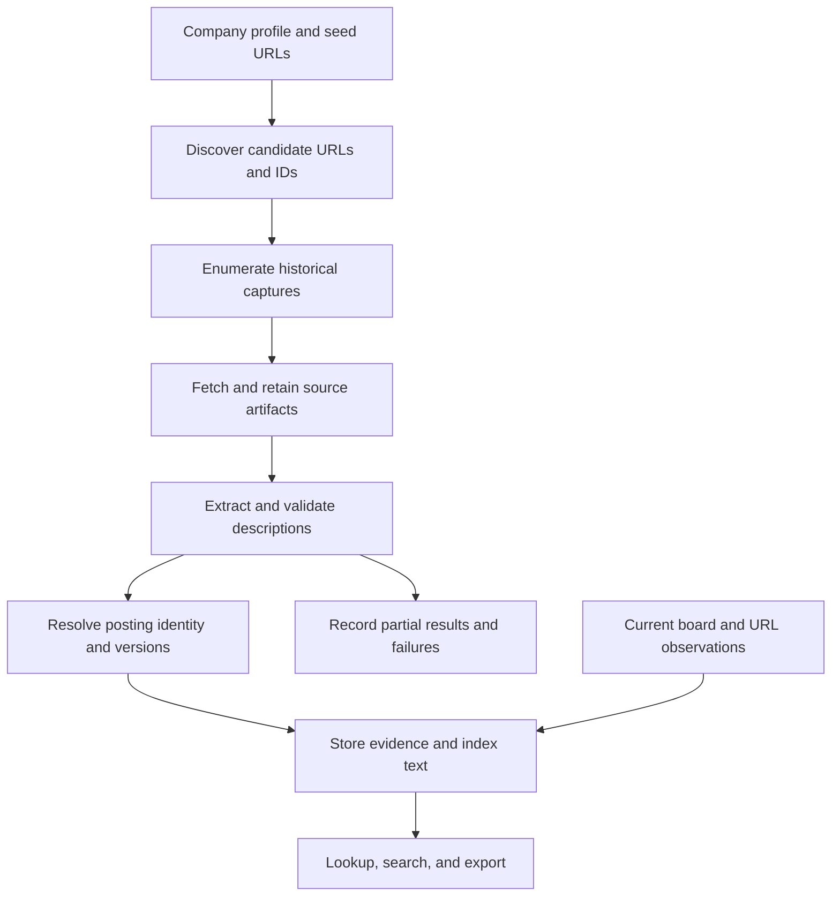

# Historical Job Posting Recovery Engine — Implementation Plan

Updated: October 8, 2026. Status: proposed implementation; no engine has been built.

Build a local engine that discovers one company's historical job postings, recovers surviving descriptions, and makes the results searchable with source evidence. Start by proving recovery on real postings for that company, then implement and validate the pipeline before expanding to others.

## 1. What the supplied research establishes

The supplied [deep-research-report.md](/Users/veerr_89/Downloads/deep-research-report.md) is a general research-methodology template. Its topic is explicitly unspecified. It contains no company, historical job examples, archive coverage measurements, ATS investigation, or verifiable job-recovery sources.

Use its recommendations about scope, source tracking, reproducible searches, and quality review. The recovery strategy below is an engineering proposal informed by official documentation reviewed for this plan. Company-specific feasibility remains untested.

The core limitation: a historical description can only be recovered if its content survives in an archive, a still-accessible page, an attributable copy, or a previous capture. Finding a URL or job title does not establish that the description is recoverable. The engine must report gaps rather than generate missing text.

## 2. First-company scope and pending inputs

| Decision | Initial approach |
| --- | --- |
| Target company | Pending company name and official careers URL; do not choose a substitute silently. |
| Historical window | Pending requested start/end dates. Use a clearly labeled 24-month sample for feasibility if no range is specified. |
| Regions and languages | Include those found on the company's selected boards; preserve language and location. |
| Initial user interface | Command-line lookup, local full-text search, and JSON/CSV exports. |
| Primary deliverable | Original description text, available metadata, description versions, and supporting evidence. |
| Status handling | Separate current availability, content completeness, and stated closure reason. |
| Storage | Local SQLite database plus retained raw source artifacts. |
| Expansion | A second company follows the acceptance gate in Section 10. |

Support two workflows:

1. **Recover a known posting:** accept an original job URL or a scoped job ID and look for historical descriptions.
2. **Discover historical postings:** enumerate the selected company's job URLs, recover available descriptions, and search the resulting collection.

A title query searches the local collection first. Broader source discovery is an explicit operation with a recorded budget.

Defer a web frontend, accounts, cloud deployment, vector search, and adapters for unrelated companies until the first company works. An LLM is optional later for tagging or search; it is not needed to establish recovery.

## 3. Sources and their roles

| Source | Role in the first engine | Limitation to validate |
| --- | --- | --- |
| Official careers pages and the company's public ATS board | Identify ownership, URL patterns, native IDs, current postings, and descriptions still available at known URLs. | A current board is not a historical inventory. |
| Wayback Machine | Discover captured URLs and retrieve historical detail pages, careers indexes, and captured API responses. | An index entry may lead to an inaccessible capture or an empty page. |
| Common Crawl | A second archive source when the first archive leaves meaningful gaps. | Relevant records may not exist; extraction requires locating and reading the retained payload. |
| Public search results | Find old URLs, requisition IDs, and attributable mirrors. | A snippet is discovery or partial evidence, not a complete description. |
| Public third-party copies | Recover additional text when company and posting identity can be established. | Content can be shortened, modified, reposted, or assigned misleading dates. |
| Our own snapshots | Preserve postings collected after this engine starts. | They do not recover content lost before collection began. |

Wayback's documented CDX interface supports URL scope matching, date filters, capture metadata, and continuation. Treat those as adapter capabilities to test against the deployed service. Its digest collapsing applies to adjacent records; retain capture observations and deduplicate content locally. See the [Internet Archive CDX documentation](https://github.com/internetarchive/wayback/blob/master/wayback-cdx-server/README.md).

Common Crawl provides a [URL index](https://index.commoncrawl.org/) and retained WARC response data. Query selected crawl collections and use indexed file offsets and lengths for bounded payload retrieval rather than downloading entire crawl files. See its [getting-started guide](https://commoncrawl.org/get-started) and [URL-index documentation](https://commoncrawl.org/url-index).

Select the ATS integration after identifying the target company. Greenhouse documents a public board API with description content; Lever exposes published postings; Ashby's public API returns currently published postings. None of these documents establishes a public inventory of all deleted jobs. See [Greenhouse](https://docs.greenhouse.io/job-board.html), [Lever](https://github.com/lever/postings-api), and [Ashby](https://developers.ashbyhq.com/docs/public-job-posting-api).

Firecrawl or another scraping service can be an optional transport for accessible pages. It should not be treated as an independent historical archive without demonstrated retained content. The Firecrawl CLI could not reach its service in this planning session; documentation was checked through web browsing instead. No target-company recovery requests were tested.

## 4. Phase 0: prove recovery before committing to the full engine

Estimated effort: 1–2 working days once the company is identified. This is a planning estimate, not a promised recovery rate.

### Investigation

1. Map company aliases, official career domains, ATS tenants, and any known earlier career URLs. Confirm ownership using official links.
2. Inspect a few current postings to identify description markup, structured data, job IDs, languages, and URL parameters that affect identity.
3. Assemble approximately 20–30 historical candidate postings across the chosen period, using known URLs, archived careers indexes, and archive URL discovery. Use all available candidates if fewer exist; report the smaller sample.
4. Attempt historical description recovery from Wayback. Inspect several captures across time, including captured JSON where available.
5. Probe Common Crawl for a small set of gaps. Add attributable mirrors only when needed and record their origin separately.
6. Check present-day availability of each original URL and compare against a successful, complete current board observation where possible.
7. Manually compare recovered text with its retained source, and record every unresolved or rejected candidate.

Do not build several ATS integrations during this investigation. A company can have multiple historical tenants; investigate those only when evidence shows the target used them.

### Deliverables

- `notes/company-profile.md`: confirmed domains, ATS history, patterns, source access, and scope.
- `notes/feasibility.md`: candidates attempted, recovered examples, failure reasons, observed costs, and a recommended source order.
- A small evaluation manifest referencing locally saved source artifacts and expected extraction outcomes.
- A source coverage matrix by time period and URL family, with unavailable or unqueried sections explicitly marked.

### Decision gate

The proposed practical target is at least 10 distinct historical descriptions, including at least 5 whose original descriptions are currently unavailable. These numbers are provisional engineering thresholds, not evidence that those volumes exist.

- **Proceed:** useful historical text survives, source identity is trustworthy, and retrieval is repeatable.
- **Narrow scope:** recovery works for a particular date range, legacy tenant, or role family; document that supported slice.
- **Reassess:** only titles, snippets, empty shells, or inaccessible captures survive. Report the evidence and consider an attributable historical dataset or prospective collection before building more infrastructure.

A smaller company may need a smaller gate based on its actual posting volume. Record that decision explicitly. Prospective collection is a separate capability; it must not be presented as proof of historical recovery.

## 5. Recovery pipeline



### A. Company profile and URL discovery

Store one company configuration containing aliases, approved domains and paths, ATS tenant identifiers, historical URL families, date scope, and source budgets.

Collect candidate URLs from current pages, archived careers indexes, archive indexes, and supplied seeds. An archived listing can reveal a job URL whose detail page was captured independently. Record where every candidate came from, even if its description is never recovered.

Keep original URLs. Normalize conservatively: remove only verified tracking parameters, preserve identity parameters such as `gh_jid`, and retain redirects and URL aliases. Require company/path checks on shared ATS domains so unrelated tenants cannot enter the collection.

### B. Capture selection and retrieval

For known URLs, enumerate historical observations first. For discovery, use the company's career path prefixes and verified tenant patterns; partition broad queries into bounded windows.

Record the complete index metadata returned within the budget. Fetch representative earlier and later captures and additional content variants; record anything skipped. Preserve error and redirect observations even when selecting successful payloads for description extraction.

Track requested and actual capture timestamps. Archive replay can redirect to another capture or another URL; validate the final source and avoid presenting current live text as an archived description. Never use live JavaScript API responses to fill an old archived shell.

For Common Crawl, retain collection, filename, offset, length, WARC target URL, and record timestamp. Validate the range response and record type before parsing. Treat truncated records or unresolved revisits as explicit partial/failure outcomes.

### C. Extraction and validation

Prefer deterministic extraction in this order: source-native JSON fields, matching `JobPosting` structured data, embedded page data, then the company-specific HTML description container.

Extract title, company, location, employment type, department, native identifiers, language, declared dates, and description HTML/text when present. Keep nullable fields; do not guess missing dates or salary.

Classify every payload:

- `full`: the available source contains the complete role-specific description and extraction preserves it, with no detected truncation. This does not prove completeness of an earlier original when the source is a mirror.
- `partial`: genuine role-specific text survives but is truncated, snippet-only, or missing visible sections.
- `metadata_only`: title, ID, location, or a listing entry survives without substantive description text.
- `none`: no usable posting content.

Company boilerplate, generic career pages, expired notices, login pages, and empty JavaScript shells are not descriptions. Length can flag suspicious content but cannot establish completeness. Preserve responsibilities, qualifications, benefits, compensation, and other sections that actually appear in the source.

Never merge different captures or mirrors into one purported original description. Expose separate versions and conflicts with their evidence.

### D. Identity resolution and versioning

Use company + provider + tenant + native posting ID as the preferred posting identity. Preserve a distinct requisition/internal-job ID when provided; a posting and an internal requisition need not be the same entity.

Without IDs, use verified URL relationships and corroborating metadata. Matching titles are insufficient. Keep uncertain matches separate with a suggested relationship for review.

Store repeated observations separately from content versions. A description change creates a version; identical content at different capture times adds evidence. Keep different languages and ambiguous reposts distinct. If an identifier appears reused for an unrelated role, retain a separate occurrence rather than overwriting history.

### E. Persistence, search, and export

Save source bytes and metadata before publishing extracted records. Use atomic writes, hashes, database transactions, and schema migrations. Record parser/extraction versions so saved artifacts can be reprocessed without network requests.

Index title and description text locally. Search filters should include company, location, language, capture range, source, and completeness. Date filters must identify whether they refer to capture dates or source-declared posting dates.

Detail output should show the selected description version, other versions, source links, capture/retrieval dates, completeness, and dated availability evidence. Prefer the latest validated official historical version by default, allow an as-of date, and keep mirror-only versions clearly attributed. Never silently substitute a newer version when an as-of query has no supporting capture.

## 6. Evidence, status, and date rules

### Independent status dimensions

| Dimension | Values | Evidence rule |
| --- | --- | --- |
| Original URL availability | `accessible`, `unavailable`, `unknown` | Based on a dated request. An accessible URL may contain only an expired notice. Network errors and blocked requests mean unknown. |
| Current board membership | `listed`, `not_listed`, `unknown` | Absence requires a successful complete observation of the relevant board/tenant, including its pagination. |
| Recovery completeness | `full`, `partial`, `metadata_only`, `none` | Based on recovered source content and extraction validation. |
| Stated closure reason | `explicitly_closed`, `explicitly_filled`, `unknown` | Requires attributable explicit wording or a documented status field tied to this posting. |

An archived capture proves historical presence at that capture time. A 404/410 proves that a URL was unavailable at the observation time. Neither establishes that the position was filled, why it disappeared, or its closing date. “Deleted” can be a user search term, but the engine should return observed unavailability unless deletion itself is explicitly evidenced.

Preserve the last successful observation when a source fails, while showing its age and the failed refresh. A failed or incomplete listing run must never change every unseen posting to `not_listed` or closed. A current board listing establishes publication, not certainty that hiring is still active.

### Dates

Store these independently, with their precision and source:

- Archive capture time.
- Engine retrieval time.
- Source-declared publication, update, expiration, or closure time, when present.
- Earliest/latest observed presence in the checked sources.
- Current availability observation time.

First capture is not posting date. Last capture is not closing date. Expiration is not evidence of a hire. Observed dates describe the queried evidence, not the entire lifetime of a job. An archive capture outside the requested window may be used as supporting evidence, but must be labeled outside scope.

### Provenance and confidence

Each extracted field and status assertion references a source capture plus a JSON path, selector, or short evidence excerpt. Separate company-identity confidence from content completeness. Use reviewable labels such as `verified`, `supported`, and `needs_review` with reasons; do not invent probability scores.

## 7. Minimal architecture and data model

Recommended stack: Python 3.11+ in a per-project virtual environment; `httpx` for requests, Pydantic for record validation, Beautiful Soup/lxml for HTML, Typer for the CLI, and SQLite for persistence. Add `warcio` only if the Common Crawl probe justifies that adapter. Use pytest for meaningful parser, identity, and failure-behavior checks. Pin actual versions during implementation.

Use SQLite FTS5 if available in the selected interpreter; verify it during setup. Keep retrieval workers bounded and serialize database writes. A persistent SQLite work queue is sufficient initially; introduce no separate queue server.

| Table | Purpose and essential fields |
| --- | --- |
| `companies` | Company key, aliases, profile/config version. |
| `sources` | Provider, tenant/domain, URL families, scope and access configuration. |
| `runs` | Config snapshot, budgets, timestamps, completion/partial state, counts and errors. |
| `candidates` | Original/canonical URL, native ID hints, discovery evidence, rejection reason. |
| `work_items` | Operation, stable task key, state, attempts, continuation/checkpoint, last error. |
| `captures` | Source locator, requested/final URLs, capture/retrieval times, original and retrieval HTTP results, hashes, artifact paths, WARC locator where applicable. |
| `postings` | Local posting key, company/source scope, native posting and requisition IDs, identity confidence. |
| `posting_versions` | Posting, language, description HTML/text, content hash, metadata and completeness. |
| `version_evidence` | Links versions to captures; records extraction version, field provenance, and review outcome. |
| `observations` | Dated availability, membership, and explicit closure assertions with supporting capture and scope. |

Use unique task/capture/version keys to prevent duplicate ingestion. Retain many-to-many evidence links: one board payload may contain several postings and several captures may support one version. Reprocessing with a new parser is an explicit operation, not a reason to discard earlier evidence.

Keep source adapters responsible for discovery and retrieval; keep extraction, identity resolution, storage, and search separate. Implement the target company's confirmed source shapes first.

Proposed layout, to create during implementation:

```text
config/companies/<company>.yaml
src/archvive/
  cli.py
  models.py
  adapters/             # Target company's source adapters
  extraction/           # JSON and company-specific HTML parsing
  identity.py
  pipeline.py
  storage.py
  search.py
migrations/
tests/fixtures/
notes/
data/                   # Gitignored database and raw artifacts
exports/                # Gitignored generated outputs
pyproject.toml
```

## 8. Reliability and collection controls

- Start with one in-flight request per source host, configurable delays, explicit timeouts, bounded retries, and backoff. Honor `Retry-After` where provided. Common Crawl specifically requests serialized, spaced index calls; see its [FAQ](https://www.commoncrawl.org/faq).
- Cap candidates, index pages, payload fetches, bytes, elapsed time, and paid-provider usage for every run. Report skipped work and exhausted budgets as partial coverage.
- Cache index results and retained payloads. Retry transient failures later; distinguish `no_capture`, `payload_unavailable`, `blocked`, `rate_limited`, `timeout`, `shell_only`, and `parse_failed`.
- Persist checkpoints so interruption resumes without refetching completed work. A run is complete only when its configured tasks finish; completion never means every historical company job has been found.
- Restrict collection to configured public source domains and paths, validate redirect destinations, and reject private-network targets. Respect applicable source access rules; do not depend on bypassing authentication or access controls.
- Parse archived HTML as inert content. Escape it before any future display; browser rendering is conditional on a demonstrated need and cannot substitute present-day content for historical evidence.
- Keep raw captures and databases out of Git. Retain a small attributable fixture set for tests, keep secrets outside config committed to Git, and support local database/artifact backup.

## 9. Implementation sequence

Effort estimates assume one engineer and accessible sources. Re-estimate after Phase 0; historical coverage is the largest unknown.

| Phase | Work | Deliverable / exit condition | Rough effort |
| --- | --- | --- | --- |
| 0 | Company profile, source probes, manual recovery sample. | Feasibility evidence and proceed/narrow/reassess decision. | 1–2 days |
| 1 | Project setup, config validation, migrations, artifact storage, CLI skeleton, fixtures. | Saved artifacts can be parsed and searched offline with provenance. | 1–2 days |
| 2 | Known-URL Wayback recovery and target-specific extraction. | One command recovers a known historical posting, persists versions, and explains failures. | 2–3 days |
| 3 | Company-wide URL discovery, archived index parsing, checkpoints, identity resolution. | Bounded historical run resumes safely and produces a reviewed corpus. | 2–3 days |
| 4 | Add Common Crawl or a verified mirror source if measured gaps justify it. | Measurable incremental recoveries with independently attributed evidence. | 1–3 days, conditional |
| 5 | Full-text lookup, filters, detail views, exports, evaluation, usage documentation. | First-company acceptance gate passes. | 1–2 days |

Start capturing current descriptions once the target adapter and storage work. After recovery is validated, add a separate refresh command for prospective preservation. The scheduler and frequency can be chosen later; this plan does not create a scheduled task.

Proposed CLI contract, not commands available today:

```text
archvive profile validate --company <key>
archvive recover --company <key> --url <original-job-url>
archvive discover --company <key> --from <date> --to <date>
archvive recover --company <key> --pending
archvive resume --run <run-id>
archvive search --company <key> --query <text> --completeness full
archvive show --posting <local-id> --versions
archvive export --company <key> --format json --output <path>
archvive evaluate --company <key> --benchmark <manifest-path>
archvive snapshot-current --company <key>
```

## 10. Evaluation and first-company acceptance gate

Build a manually reviewed benchmark during Phase 0. Include confirmed recoverable historical descriptions and difficult cases: index-only records, unavailable payloads, snippets, redirects, expired notices, empty shells, malformed JSON, repeated captures, changed descriptions, and separate postings with the same title. Keep development fixtures and a small held-out review set separate where sample size permits.

Use these measures:

| Measure | Definition |
| --- | --- |
| Description extraction precision | Accepted full descriptions that match the correct posting and retained source / all full-description claims reviewed. |
| Recovery recall on known recoverable cases | Benchmark postings recovered as full / benchmark postings manually confirmed to have a full accessible source. |
| Discovery recall on known seeds | Independently known in-scope benchmark postings found / those independently known postings. |
| Observed yield | Full, partial, metadata-only, and unresolved counts among discovered candidates, broken down by source and time period. |
| Incremental source yield | Additional distinct descriptions recovered by a fallback beyond the primary sources. |
| Operational cost | Requests, bytes, elapsed time, retry counts, and paid usage if enabled. |

Never call observed yield “percentage of all company jobs recovered.” The total historical posting population is unknown without an authoritative inventory.

Proposed acceptance criteria:

- [ ] Phase 0 establishes useful historical recovery for the agreed company/scope.
- [ ] Every accepted description and status assertion has a retained source and dated evidence.
- [ ] At least 95% extraction precision and 90% recall on the known recoverable benchmark; report raw counts because small samples make percentages unstable.
- [ ] Zero unsupported `explicitly_filled` labels, fabricated dates, or current-content substitutions in reviewed cases.
- [ ] Distinct same-title postings and conflicting versions remain distinct.
- [ ] Re-running the same ingestion adds no duplicate postings or content versions; refreshed observations remain traceable.
- [ ] Interrupt/resume, partial pagination, 429/503 responses, timeouts, and parser failures produce explicit outcomes without false closure assertions.
- [ ] Offline re-extraction from saved artifacts works, and search/export includes descriptions, versions, evidence, and missing-field markers.
- [ ] Coverage exclusions and remaining gaps are documented before adding a second company.

If a criterion fails, fix the pipeline or narrow and document the supported scope. Increasing the number of companies must not hide first-company failures.

## 11. First implementation backlog

1. Confirm the company, careers URL, historical date range, and any known old job URLs or IDs.
2. Create the company profile and perform Phase 0 source probes.
3. Retain reviewed positive and negative examples; record the feasibility decision.
4. Implement local artifact storage and the evidence schema.
5. Build known-URL recovery through the source proven useful in Phase 0, with deterministic company-specific extraction.
6. Add historical discovery, identity/version handling, and resumable bounded collection.
7. Add fallback retrieval only where it improves measured recovery.
8. Add local search, exports, evaluation, and operating instructions.
9. Pass the acceptance gate, then use the first implementation to define the next company's adapter.

The first concrete milestone is a reproducible recovery of a real historical description from a currently unavailable posting, accompanied by its retained source, original URL, actual capture date, and an honest statement of what remains unknown.
